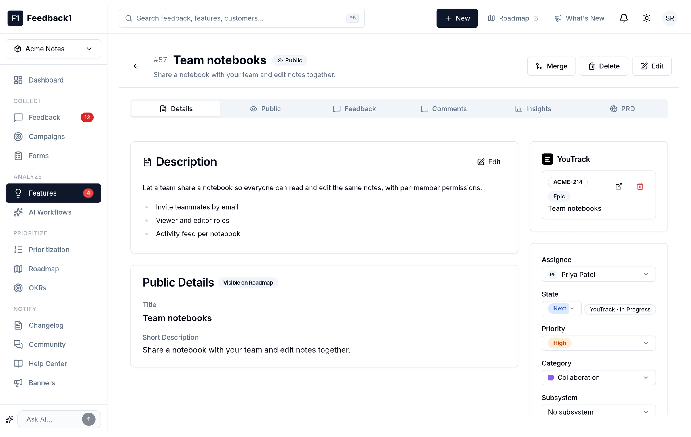
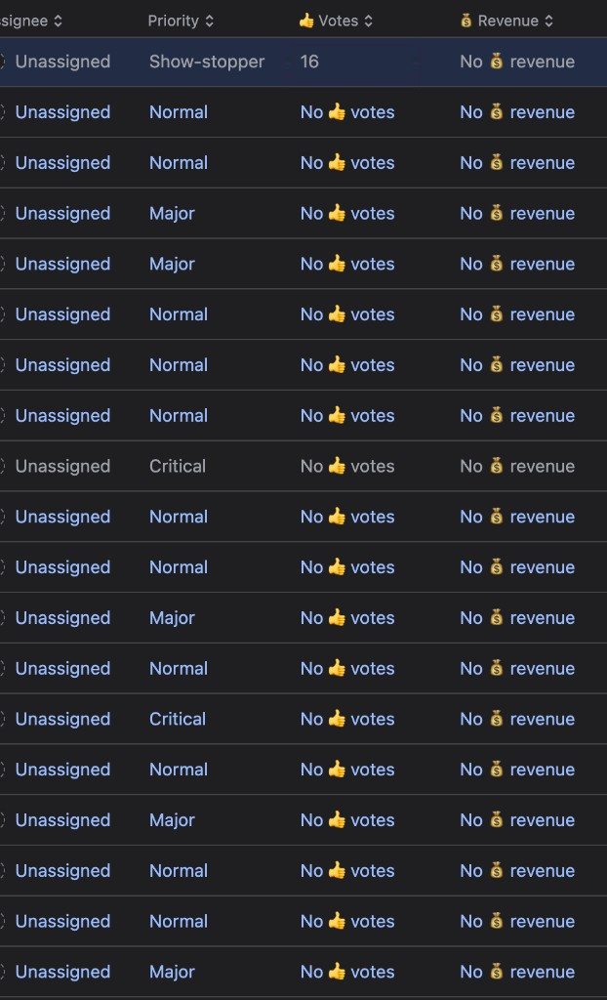
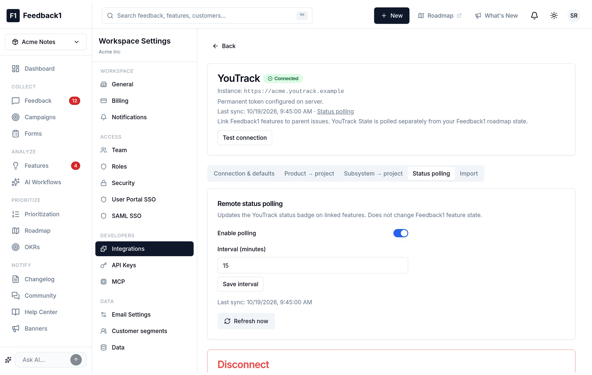

  

<h1 align="center">Feedback1 for YouTrack</h1>

  Show linked Feedback1 features on issues — votes, revenue, roadmap status — and push YouTrack State back to Feedback1.

  <strong>YouTrack 2026.2.0+</strong> · App package <strong>1.1.5</strong>

---

## Screenshots

### Linked issue card

Priority and title, feature id and **Open in Feedback1**, vote count (with feedback), revenue (`$16k` or `-`), and Feedback1 roadmap status.

### Issues list columns

Integer fields **👍 Votes** and **💰 Revenue** sync when an issue is opened (requires app attach + backend requirements).

### App settings

Product-scoped API key and optional **Show revenue**.

---

## Install

1. In Feedback1: **Settings → API Keys** — create a key for the product you map to YouTrack.
2. In Feedback1: **Settings → Integrations → YouTrack** — connect with a permanent token. Link features to parent issues (adds a `feedback1` tag on the issue).
3. Pack: `./pack.sh` → upload `feedback1-youtrack-app.zip` in **YouTrack → Administration → Apps** (or install from [Marketplace](https://plugins.jetbrains.com/plugin/youtrack_app) when published).
4. Attach the app to each project. If YouTrack flags **backend** requirements, use **Fix** to create or map **👍 Votes** and **💰 Revenue** (integer).
5. Paste the Feedback1 API key; optionally enable **Show revenue**.
6. Map **State** when the State workflow prompts you.

Full integration guide: [feedback1.ai/docs/integrations/youtrack](https://feedback1.ai/docs/integrations/youtrack)

---

## What it does

- **Card** (issue field panel): priority + title; feature id + open link; votes, revenue, Feedback1 roadmap status.
- **Issues list**: **👍 Votes** / **💰 Revenue** updated on issue open (not live for every row until visited).
- **Workflow**: when **State** changes on a `feedback1`-tagged issue, POST to Feedback1 → updates link badge only (not Feedback1 roadmap status).
- **Poll** in Feedback1 remains a fallback if the app is not installed.

---

## Development

| Path | Role |
|------|------|
| `backend.js` | Issue-context HTTP handler + list field sync |
| `push-state.js` | State → Feedback1 workflow |
| `widgets/issue-card/` | Issue panel widget |
| `MARKETPLACE.md` | Listing copy for JetBrains |
| `pack.sh` | Zip for upload (see `.gitignore` for local zip) |

Requires YouTrack **2026.2.0+** for async HTTP from the handler.

---

## Vendor

**[Feedback1](https://feedback1.ai)** · hello@feedback1.ai
